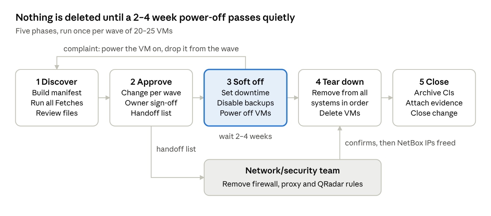

# VM Decommissioning User Guide

Nov 11, 2026

## Purpose and scope

This guide explains how to decommission vSphere VMs in waves of 20–25, using one manifest file and a set of PowerShell scripts that fetch, review and then delete each VM's footprint. It is written for the engineers running the decommission and the people who approve it.

A VM counts as fully decommissioned when every item below is done:

| # | Item | System | Done by |
| --- | --- | --- | --- |
| 1 | Computer object removed | Active Directory | Infrastructure team |
| 2 | DNS records for the VM's IPs and names removed | Microsoft DNS | Infrastructure team |
| 3 | IP reservation released | NetBox (IPAM) | Infrastructure team |
| 4 | Associated databases removed | SQL Server / PostgreSQL | Infrastructure team + DBA |
| 5 | Associated jobs removed | OpCon | Infrastructure team + scheduling owner |
| 6 | Removed from patching | SCCM (Windows) or Red Hat Satellite (Linux) | Infrastructure team |
| 7 | Monitoring removed | Checkmk | Infrastructure team |
| 8 | Backup jobs stopped, client retired | Commvault | Infrastructure team |
| 9 | Firewall rules removed | Firewall | Network/security team |
| 10 | Proxy rules removed | Proxy | Network/security team |
| 11 | Log source removed | QRadar | Network/security team |
| 12 | VM deleted | vSphere | Infrastructure team |
| 13 | CI set to archived/retired | ServiceNow | Infrastructure team |

Out of scope: physical servers, and moving a workload somewhere else before its VM is decommissioned.

## Roles and responsibilities

The infrastructure team runs the process end to end. Other teams approve, confirm or carry out their own part.

| Role | Responsibilities |
| --- | --- |
| Decommission engineer (infrastructure team) | Builds the manifest, runs the scripts, validates the review files, raises the change, keeps the tracker up to date |
| App owner | Confirms each VM can go, confirms which databases, jobs and DNS aliases can be removed, reports problems during the power-off period |
| DBA | Confirms database ownership on shared instances, approves the final backup and the DROP |
| Scheduling (OpCon) owner | Confirms which jobs and machine groups can be removed |
| Network/security team | Removes firewall rules, proxy rules and QRadar log sources from the handoff list, then confirms on the ticket |
| Change approver (CAB) | Approves the change for each wave |

## Process overview

Each wave of 20–25 VMs goes through five phases, and nothing is deleted until the VMs have been powered off for 2–4 weeks without complaint.



The network/security team works in parallel from the handoff list; NetBox IPs are only released after they confirm. Group each wave by app owner, and run a pilot wave of about 5 VMs first to prove the process.

## Prerequisites

Run the scripts from a Windows admin workstation with Windows PowerShell 5.1 or PowerShell 7, the modules below, and accounts that have the listed rights.

The scripts work on both versions. On Windows PowerShell 5.1 they turn on TLS 1.2, send basic authentication themselves, and read large JSON responses without the 2 MB limit that 5.1 applies, so you don't need to change anything. If your API servers use a certificate from an internal CA, the workstation must trust that CA: the scripts don't skip certificate checks.

**Modules and tools**

| Needed for | Install |
| --- | --- |
| vSphere | `Install-Module VMware.PowerCLI` |
| AD and DNS | RSAT: Active Directory and DNS Server tools (`ActiveDirectory`, `DnsServer` modules) |
| Databases | `Install-Module SqlServer` |
| SCCM | ConfigurationManager console installed on the workstation |
| NetBox, OpCon, Checkmk, Commvault, Satellite, ServiceNow | Nothing extra: REST calls with `Invoke-RestMethod` |

**Access**

| System | Rights needed |
| --- | --- |
| vCenter | Power off and delete VMs, edit notes |
| Active Directory | Disable and delete computer objects, including child objects |
| DNS | Read all zones, delete records |
| NetBox | API token with change and delete rights on IP addresses and VMs |
| SQL Server | Read sessions and logins on shared instances; backup and DROP rights (DBA runs these if you don't have them) |
| OpCon | API user that can read and delete master jobs and machines |
| SCCM | Remove devices |
| Satellite | Delete hosts in the right organizations |
| Checkmk | Automation user that can edit hosts, set downtimes and activate changes |
| Commvault | Disable backups and retire clients |
| ServiceNow | Update CI records |

**Environment variables** (set them in your session; never store secrets in the scripts or on Confluence)

```
$env:NETBOX_URL    = 'https://netbox.corp.example.com'
$env:NETBOX_TOKEN  = '<token>'
$env:OPCON_URL     = 'https://opcon.corp.example.com:9010'
$env:SATELLITE_URL = 'https://satellite.corp.example.com'
$env:CMK_URL       = 'https://monitor.corp.example.com/<site>'
$env:CMK_USER      = '<automation user>'
$env:CMK_SECRET    = '<automation secret>'
$env:CV_URL        = 'https://commserve.corp.example.com/webconsole/api'
$env:SNOW_URL      = 'https://<instance>.service-now.com'
```

OpCon, Commvault, Satellite and ServiceNow prompt for credentials when they run.

**Script folder**

```
decom/
  _common.ps1          shared helpers (review files, dry run, logging)
  vm-list.txt          input: one VM name per line
  manifest.csv         built by 00-vsphere.ps1, then edited by you
  00-vsphere.ps1       manifest, power off, delete VM
  01-ad.ps1            Active Directory
  02-dns.ps1           DNS
  03-netbox.ps1        NetBox
  04-databases.ps1     databases
  05-opcon.ps1         OpCon
  06-patching.ps1      SCCM and Satellite
  07-checkmk.ps1       Checkmk
  08-commvault.ps1     Commvault
  09-servicenow.ps1    ServiceNow
  10-handoff.ps1       list for the network/security team
  11-similar.ps1       similar VM names in vCenter
  PSScriptAnalyzerSettings.psd1   rules for checking the scripts
  reports/             review files, handoff lists, results.csv log
```

## How the scripts work

Every script follows the same four steps, so nothing is deleted until a person has checked it and run the command a second time with `-Execute`.

1. **Fetch.** `-Mode Fetch` finds everything tied to the wave's VMs and writes `reports/<system>-review.csv`. Each row has an **Action** column already filled in (`Delete`, `Review` or `None`) and a **Reason** for anything unclear.
2. **Review.** Open the review file. Change every `Review` row to `Delete` or `Keep`, and check that the `Delete` rows are right. Get the app owner, DBA or scheduling owner to confirm where the guide says so.
3. **Dry run.** Run the delete mode without `-Execute`. The script prints `[DRY-RUN]` for each row marked `Delete` and changes nothing.
4. **Execute.** Run the same command with `-Execute`. Only rows marked `Delete` are acted on.

Every action, including dry runs, is logged to `reports/results.csv` with a timestamp, hostname, step, status and detail. Statuses are `DryRun`, `Done`, `AlreadyGone` and `Failed`. Re-running a script is safe: an object that is already removed is logged as `AlreadyGone`, not `Failed`.

Example for one system:

```
.\02-dns.ps1 -DnsServer dc01 -Mode Fetch  -Wave 1     # writes reports\dns-review.csv
# ...review and edit the Action column...
.\02-dns.ps1 -DnsServer dc01 -Mode Delete -Wave 1     # dry run
.\02-dns.ps1 -DnsServer dc01 -Mode Delete -Wave 1 -Execute
```

The review files and `results.csv` are the audit evidence for the change. Keep a copy of the `reports` folder for each wave and attach it to the change request.

### Checking the scripts before first use

Check the scripts after you copy them to a new workstation, and again after anyone edits them. This needs no access to the target systems.

1. Install the analyzer once (PowerShell Gallery access needed):

   ```
   Install-Module -Name PSScriptAnalyzer -Scope CurrentUser -Repository PSGallery
   ```

2. Run it from the script folder. The settings file skips two rules that are intentional here: coloured console output (`Write-Host`) and the empty `catch` in `04-databases.ps1` that probes for a local SQL Server.

   ```
   Invoke-ScriptAnalyzer -Path . -Settings ./PSScriptAnalyzerSettings.psd1
   ```

3. Expect exactly 4 `PSReviewUnusedParameter` warnings. They are false positives: the analyzer can't see parameters used inside functions and script blocks.

   | Script | Parameter | Where it is used |
   | --- | --- | --- |
   | `06-patching.ps1` | `SiteCode`, `SiteServer` | `Connect-CM` function |
   | `09-servicenow.ps1` | `SnowUrl` | `Get-Sn` function and the Archive block |
   | `00-vsphere.ps1` | `Change` | PowerOff block, written into the VM notes |

   Any other finding needs a look before you run a wave.

The scripts have been checked for syntax errors, checked by the analyzer for Windows PowerShell 5.1 and 7 compatibility, and tested offline for how they read the manifest, handle review files, and run dry runs and `-Execute`. The calls to your own systems have not been tested, and nothing has yet been run on a real Windows PowerShell 5.1 (all testing so far was on PowerShell 7), so run the Fetch modes on the pilot wave first, using the PowerShell version you will use for the rest. They are read-only.

A step only changes something when its own `-Execute` switch is passed. A stray `$Execute` variable in your PowerShell session cannot turn a dry run into a real run.

## Phase 1: Discover

Build the manifest and run every Fetch while the VMs are still powered on. VMware only reports guest IPs and hostnames from a running VM, and live database sessions only show while the app is running.

1. Put the VM names in `vm-list.txt`, one per line.
2. Build the manifest:

   ```
   .\00-vsphere.ps1 -VCenter vc01 -Mode Fetch
   ```
3. Open `manifest.csv` and complete it:
   - **Wave:** group VMs by app owner, 20–25 per wave. Make wave 1 a pilot of about 5 VMs.
   - **Owner** and, if you know it, **SnowSysId**.
   - Fix every row with a note. `Not found in vCenter` means a wrong name. `No guest IPs` means VMware Tools isn't running: take the IPs from NetBox.
   - Check **Hostname**. It must be the AD computer name, which can differ from the vCenter VM name.
4. Run Fetch for every system:

   ```
   .\01-ad.ps1         -Mode Fetch -Wave 1
   .\02-dns.ps1        -Mode Fetch -Wave 1 -DnsServer dc01
   .\03-netbox.ps1     -Mode Fetch -Wave 1
   .\04-databases.ps1  -Mode Fetch -Wave 1 -SqlInstances sqlcl01\PROD,sqlcl02
   .\05-opcon.ps1      -Mode Fetch -Wave 1
   .\06-patching.ps1   -Mode Fetch -Wave 1 -SiteCode P01 -SiteServer sccm01
   .\07-checkmk.ps1    -Mode Fetch -Wave 1
   .\08-commvault.ps1  -Mode Fetch -Wave 1
   .\09-servicenow.ps1 -Mode Fetch -Wave 1
   ```
5. Check for similarly named VMs, for example `VMTEST010` still running while you decommission `VMTEST010-OFF`. This only reads from vCenter:

   ```
   .\11-similar.ps1 -VCenter vc01 -Wave 1
   ```

   It writes `reports\similar-hosts.csv`. Resolve every `WARNING` and `CHECK` row before approval:

   | Flag | Meaning | What to do |
   | --- | --- | --- |
   | `WARNING` | A similar VM is powered on and not on your list | Confirm with the app owner that it is not the live server. If the wrong VM is on the list, take it out of the wave |
   | `CHECK` | A similar VM is powered off and not on your list | Find out whether it is a leftover or the real server switched off |
   | `INFO` | The similar VM is also on your list | No action |
   | `NONE` | Nothing similar found | No action |

   The check compares names only: it ignores suffixes such as `-OFF` and `-OLD`, and ignores names that differ only by a number (`web01` and `web02`).
6. Run the database Fetch again on two or three more days before the power-off. It only sees connections open at that moment.
7. Review every file in `reports\` as described in [How the scripts work](#how-the-scripts-work) and in the System reference below. Note any VM that needs to stay, and take it out of the wave.

## Phase 2: Approve

Raise one change request per wave and get the app owner's sign-off on every VM in it before anything is powered off.

1. Raise a ServiceNow change for the wave. Attach `manifest.csv` filtered to the wave, plus the review files from Phase 1.
2. Get written sign-off from each app owner on:
   - the VMs to decommission
   - the databases, OpCon jobs and DNS aliases (CNAMEs) marked `Delete`
3. Build the list for the network/security team:

   ```
   .\10-handoff.ps1 -Wave 1
   ```

   This writes `reports\handoff-wave-1.csv`: one row per IP, with every DNS name for it.
4. Raise **one ticket per wave** to the network/security team with that file attached, asking them to remove firewall rules, proxy rules and QRadar log sources. They can start once the VMs are powered off; NetBox IPs are not released until they confirm.

## Phase 3: Soft off

Power the VMs off and switch off everything that would alert or run against them, then wait 2–4 weeks. Nothing is deleted in this phase, so rolling back is just powering the VM on again.

Run the steps in this order, each with a dry run first and then `-Execute`:

1. Set downtime in Checkmk, so the power-off doesn't raise alerts:

   ```
   .\07-checkmk.ps1 -Mode Downtime -Wave 1 -DowntimeDays 30 -Execute
   ```
2. Take the OpCon agent machines down:

   ```
   .\05-opcon.ps1 -Mode MachineDown -Wave 1 -Execute
   ```
3. Disable Commvault backups. Existing backups are kept:

   ```
   .\08-commvault.ps1 -Mode DisableBackup -Wave 1 -Execute
   ```
4. Mark the NetBox records as going away (IPs `deprecated`, VMs `decommissioning`):

   ```
   .\03-netbox.ps1 -Mode Deprecate -Wave 1 -Execute
   ```
5. Optional: disable the AD computer objects:

   ```
   .\01-ad.ps1 -Mode Disable -Wave 1 -Execute
   ```
6. Shut the VMs down. The script writes the wave and change number into each VM's notes:

   ```
   .\00-vsphere.ps1 -VCenter vc01 -Mode PowerOff -Wave 1 -Change CHG0012345 -Execute
   ```
7. Tell the app owners the waiting period has started and when it ends.

During the waiting period, treat any complaint as a reason to stop. Power the affected VM back on, take it out of the wave, and find out what still depends on it.

## Phase 4: Tear down

After a quiet waiting period, remove the VMs from every system in the order below. Do a dry run of each step, check the output, then run it with `-Execute`.

1. **Commvault:** retire the clients. Backup data is kept until its retention period ends.

   ```
   .\08-commvault.ps1 -Mode Retire -Wave 1 -Execute
   ```
2. **OpCon:** delete the approved master jobs, then the machine definitions.

   ```
   .\05-opcon.ps1 -Mode Delete -Wave 1 -Execute
   ```
3. **Checkmk:** delete the hosts. The script activates the changes once at the end.

   ```
   .\07-checkmk.ps1 -Mode Delete -Wave 1 -Execute
   ```
4. **Databases:** take a final backup, then drop the approved databases and logins. Confirm with the DBA first.

   ```
   .\04-databases.ps1 -Mode Delete -Wave 1 -BackupPath '\\backup\decom' -Execute
   ```
5. **Active Directory:** delete the computer objects.

   ```
   .\01-ad.ps1 -Mode Delete -Wave 1 -Execute
   ```
6. **SCCM / Satellite:** remove the devices and hosts, on the same day as step 5. If SCCM's AD discovery runs while the AD object still exists, the device comes back.

   ```
   .\06-patching.ps1 -Mode Delete -Wave 1 -SiteCode P01 -SiteServer sccm01 -Execute
   ```
7. **DNS:** remove the approved records.

   ```
   .\02-dns.ps1 -DnsServer dc01 -Mode Delete -Wave 1 -Execute
   ```
8. **Wait for the network/security team** to confirm on their ticket that the firewall rules, proxy rules and QRadar log sources are removed.
9. **NetBox:** delete the IPs (this frees them for reuse), then the VM objects. Never do this before step 8: a new server given the same IP would inherit the old firewall and proxy rules.

   ```
   .\03-netbox.ps1 -Mode Delete -Wave 1 -Execute
   ```
10. **vSphere:** delete the VMs. The script refuses to delete a VM that is powered on.

    ```
    .\00-vsphere.ps1 -VCenter vc01 -Mode Delete -Wave 1 -Execute
    ```

## Phase 5: Close

Set the CIs to retired or archived in ServiceNow, attach the evidence, and close the change.

1. Check which status values your instance uses (they differ between instances):

   ```
   .\09-servicenow.ps1 -Mode Choices
   ```
2. Update the CIs, passing the values from step 1 (out of the box, `7` and `6` both mean Retired):

   ```
   .\09-servicenow.ps1 -Mode Archive -Wave 1 -InstallStatus 7 -OperationalStatus 6 -Execute
   ```
3. Check `reports\results.csv` for any `Failed` rows. Fix and re-run those steps before closing.
4. Zip the `reports` folder for the wave and attach it to the change request.
5. Close the change and the network/security ticket.

## System reference

What each script finds, what to check before approving its rows, and the traps to know about.

| System | Script | What Fetch finds | Check during review | Watch out for |
| --- | --- | --- | --- | --- |
| vSphere | `00-vsphere.ps1` | VM name, guest hostname, all IPv4 addresses, OS, cluster, folder | Every row has IPs and a correct AD hostname | Run Fetch before power-off: no IPs are reported from a VM that is off |
| vSphere (similar names) | `11-similar.ps1` | Other VMs whose name matches the target once suffixes like -OFF and -OLD are ignored, with power state, cluster and IPs | Every WARNING and CHECK row: is the similar VM the live server? | Compares names only: a renamed server, or a clone with an unrelated name, is not found. Names that differ only by a number (web01, web02) are ignored on purpose |
| Active Directory | `01-ad.ps1` | Computer object, last logon, child objects | Rows flagged `Review` logged on in the last 14 days: is the VM really unused? | Deletion is recursive and removes BitLocker keys stored under the object. Keep them first if policy requires it |
| DNS | `02-dns.ps1` | A, PTR and CNAME records matching the VM's IPs or names, across all zones | Every `Review` row: CNAMEs, other names on the VM's IP, and the VM's name pointing at a different IP | A CNAME or second A record may be a service name that has moved or must move elsewhere. Ask the app owner |
| NetBox | `03-netbox.ps1` | The VM object and its IPs, found by VM and by address | IPs assigned to a different object | Deleting a VM in NetBox doesn't delete its IPs; the script deletes IPs first. Release IPs only after the network/security team confirms |
| Databases | `04-databases.ps1` | Databases on the VM itself; live sessions from the VM and logins named after it on shared instances | Every row starts as `Review`. The DBA and app owner decide what is dropped | Fetch only sees connections open at that moment. Repeat it over several days. Dropping a login leaves orphaned database users |
| OpCon | `05-opcon.ps1` | Machine definitions and master jobs whose definition mentions the hostname | Every job row; check schedules that depend on these jobs | Jobs that run through a machine group don't name the machine: remove it from the group too. Check API endpoints against your OpCon version |
| SCCM / Satellite | `06-patching.ps1` | SCCM devices (Windows) and Satellite hosts (Linux) | Duplicate SCCM records (delete all); partial name matches in Satellite | Remove the AD object the same day, or SCCM rediscovers the device |
| Checkmk | `07-checkmk.ps1` | Hosts matching the VM's name or IP | Hosts matched only by IP | Nothing changes until changes are activated; the script does this once at the end |
| Commvault | `08-commvault.ps1` | Agent clients, and VMs backed up at hypervisor level (VSA) | VSA rows: is the VM group content rule-based or a static list? | Always retire, never delete: deleting a client can make its backups unrecoverable. Check API endpoints against your version |
| ServiceNow | `09-servicenow.ps1` | Matching CIs and their relationships | Duplicate CIs; relationships showing apps or databases that still depend on the VM | Status values differ between instances: run `-Mode Choices` first |
| Firewall, proxy, QRadar | `10-handoff.ps1` | One row per IP with every DNS name | All IPs are included, including second NICs | Run after the DNS Fetch so CNAMEs are in the list |

## Rollback and troubleshooting

Rolling back is easy until Phase 4 and gets harder with each teardown step, so stop at the first sign that a VM is still needed.

**Rollback by phase**

| Reached | How to roll back |
| --- | --- |
| Phase 1–2 | Take the VM out of the wave in `manifest.csv`. Nothing has changed |
| Phase 3 | Power the VM on. Re-enable the AD object if it was disabled. Re-enable Commvault backups and bring the OpCon machine up. Remove the Checkmk downtime and set the NetBox records back to `active` |
| Phase 4, before the VM is deleted | Power the VM on, then recreate what was removed using the review files: DNS records, NetBox IPs, Checkmk host, SCCM/Satellite registration. Rejoin the VM to the domain. Restore databases from the final backup. Re-register the Commvault client |
| VM deleted | Restore the VM from its Commvault backup while the retention period lasts, then follow the row above |

**Common problems**

| Symptom | Cause and fix |
| --- | --- |
| `No review file at ...` | Run the same script with `-Mode Fetch` first |
| A step shows `Failed` in `results.csv` | Read the detail column, fix the cause (usually access or a wrong name), and re-run the script. Completed rows are logged as `AlreadyGone` |
| SCCM device reappears | AD discovery found the computer object again. Delete the AD object, then the device |
| DNS record comes back | The VM is still running, or DHCP is registering it. Check the VM is powered off |
| Manifest has no IPs for a VM | VMware Tools isn't running. Take the IPs from NetBox and add them by hand |
| OpCon or Commvault call returns 404 or 405 | The endpoint differs in your version. Check its API documentation and adjust the script |
| ServiceNow update refused | The status value doesn't exist on your instance. Run `-Mode Choices` and pass the right values |

## Wave checklist

Copy this list for each wave and tick it off as you go.

**Phase 1: Discover**

- [ ] VM names in `vm-list.txt`, manifest built
- [ ] Manifest complete: Wave, Owner, IPs and hostnames checked, every note resolved
- [ ] Fetch run for all systems; database Fetch repeated on 2–3 days
- [ ] Similar-name check run; every `WARNING` and `CHECK` row resolved
- [ ] All review files checked, no rows left as `Review`

**Phase 2: Approve**

- [ ] Change raised for the wave, manifest and review files attached
- [ ] App owner sign-off for every VM, database, job and DNS alias
- [ ] Handoff list built and ticket raised to the network/security team

**Phase 3: Soft off**

- [ ] Checkmk downtime set
- [ ] OpCon machines down
- [ ] Commvault backups disabled
- [ ] NetBox records deprecated
- [ ] AD objects disabled (optional)
- [ ] VMs powered off, notes updated
- [ ] App owners told the end date of the waiting period
- [ ] Waiting period ended with no complaints

**Phase 4: Tear down**

- [ ] Commvault clients retired
- [ ] OpCon jobs and machines deleted
- [ ] Checkmk hosts deleted, changes activated
- [ ] Databases backed up and dropped (DBA confirmed)
- [ ] AD objects deleted
- [ ] SCCM devices / Satellite hosts removed, same day as AD
- [ ] DNS records removed
- [ ] Network/security team confirmed firewall, proxy and QRadar removal
- [ ] NetBox IPs and VMs deleted
- [ ] VMs deleted from vSphere

**Phase 5: Close**

- [ ] ServiceNow CIs set to retired/archived
- [ ] No `Failed` rows left in `results.csv`
- [ ] `reports` folder attached to the change
- [ ] Change and network/security ticket closed
